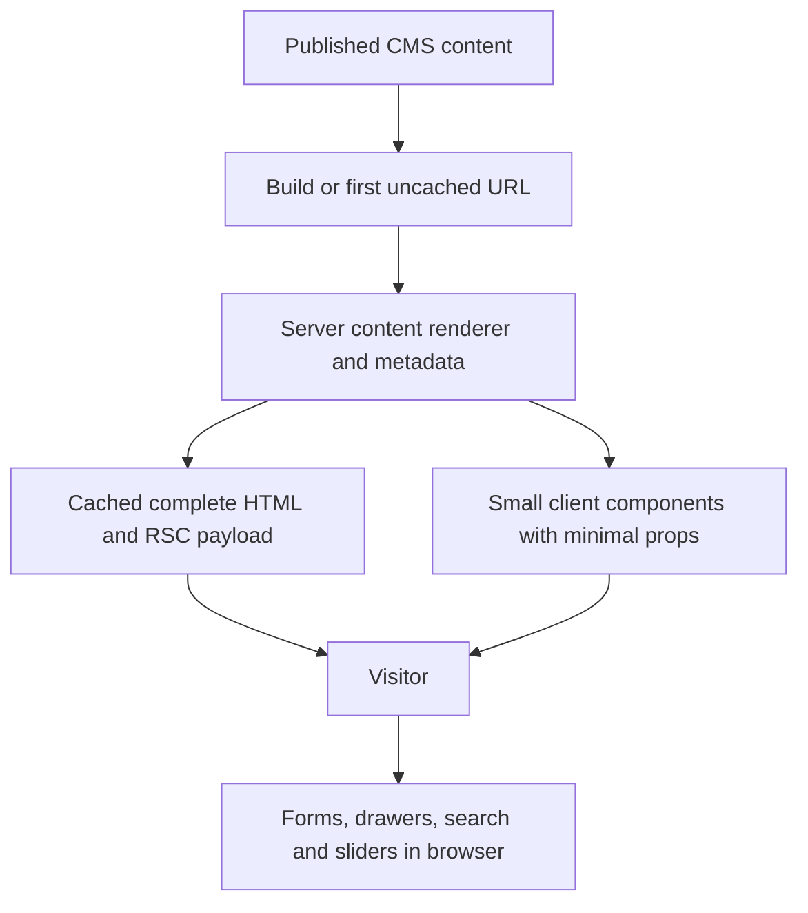

# App Router SSG migration initiative

Research date: 2026-11-02. Repository: `lumen-cms-core`, Next.js 16.4.3,
React 19.3.1, MUI 9.5.0. Status: rendering contract verified and the first real
page/locale pilot implemented in an isolated app; production CMS routes have
not been migrated. See the [pilot and comparison](app-router-pilot.md).

## Recommendation

Proceed with a measured App Router pilot for public CMS content. Keep known
published pages fully generated at build time, permit an unknown published URL
to generate on its first request, and serve the cached result thereafter.
Use no time-based regeneration initially. Publication can trigger a rebuild;
targeted publish-triggered invalidation can follow if needed.

The current app already has this basic SSG behavior. The migration earns its
place by moving CMS traversal, content transformation and noninteractive output
out of the browser. Merely wrapping the existing page in `'use client'` and
moving it into `app/` is unlikely to meet the performance objective.

Server Components can execute during static generation. Their name does not
require rendering on every request. Interactive Client Components can also
have their initial HTML prerendered. Client boundaries determine which
implementation code and props the browser needs.
[Next.js Server and Client Components](https://nextjs.org/docs/app/getting-started/server-and-client-components).

## Rendering contract

| Event                              | Required behavior                                                                                           |
| ---------------------------------- | ----------------------------------------------------------------------------------------------------------- |
| Build                              | Enumerate and fully render known published CMS paths and locales.                                           |
| Visit an already generated URL     | Serve cached HTML and navigation payload; no page render or CMS lookup.                                     |
| First visit to a new published URL | Generate complete content, cache it, then serve it.                                                         |
| Visit a nonexistent URL            | Return 404; do not cache a CMS outage as a missing story.                                                   |
| Browser interaction                | Run only the JavaScript needed for forms, navigation, search, sliders, etc.                                 |
| Content publication                | Rebuild initially; optionally invalidate affected cached routes through a verified webhook later.           |
| Draft preview                      | Separate preview route/application; draft access must not change public routes into request-rendered pages. |

This is static generation with on-demand generation, using the ISR machinery.
It requires a Next.js runtime for cache misses and invalidation. A literal
static export (`output: 'export'`) can avoid a Next rendering runtime entirely,
but cannot support ISR or new paths after deployment without another build.
Existing API endpoints and image optimization are separate runtime work from
page rendering. [Static export capabilities and limitations](https://nextjs.org/docs/app/guides/static-exports).

“Generate once” means once while a valid cache entry exists, not once forever
across deployments, cache eviction, invalidation, concurrent cold requests or
multiple independent instances. Confirm durable/shared caching on the actual
deployment. No promise of zero network requests: client navigation can fetch
an already generated RSC payload without running the page again.

## What this repository does today

| Evidence                                                                              | Finding and migration consequence                                                                                                                                                                                              |
| ------------------------------------------------------------------------------------- | ------------------------------------------------------------------------------------------------------------------------------------------------------------------------------------------------------------------------------ |
| `src/pages/[[...index]].tsx`                                                          | Re-exports `getStaticProps` and `getStaticPaths`; no public catch-all `getServerSideProps`.                                                                                                                                    |
| `src/utils/initial-props/pagesGetStaticPaths.ts`                                      | Lists CMS stories; defaults to `fallback: 'blocking'`. `NEXT_FALLBACK_MODE` can change it. `TEST`/`ANALYZE` builds deliberately enumerate only two stories plus locale homes.                                                  |
| `src/utils/initial-props/pagesGetStaticProps.ts`                                      | Fetches page/settings during generation. Adds timed ISR only when `REVALIDATE_PROPS` is populated. Preview is a separate behavior.                                                                                             |
| Existing production prerender manifest                                                | Four sampled CMS paths are complete static responses with `initialRevalidateSeconds: false`; catch-all fallback is blocking. This confirms build behavior, not deployed environment configuration.                             |
| `src/utils/initial-props/getPageProps.ts`                                             | Already prepares component data and fonts before render; good foundation for generation-time data loading. Its `SSR_CONFIG` name does not mean per-request SSR.                                                                |
| `src/components/pages/_document.tsx`                                                  | Uses `getInitialProps` for Emotion extraction. The sampled manifest still proves these pages are static. Replace this integration when adopting App Router.                                                                    |
| `src/components/layout/AppContainer.tsx`, `provider/SettingsPageProvider.tsx`         | Full page/settings documents feed browser contexts; consumers read them throughout the component tree. These boundaries currently keep a large amount of CMS data in the browser.                                              |
| `src/components/CoreComponents.tsx`, `NamedComponents.tsx`, `LazyNamedComponents.tsx` | A mutable registry, preview hooks and recursive client-capable renderers select CMS blocks. Static imports and lazy rendering have already been optimized in earlier work; the next opportunity is a server renderer boundary. |
| `src/components/section/Section.tsx`, `page/PageFrame.tsx`                            | Theme hooks, navigation state and recursive rendering are mixed with content layout. Extract content into server-rendered children and retain necessary interactive wrappers.                                                  |
| `src/pages/_app.tsx`, `components/pages/_appAuth0.tsx`                                | This application explicitly installs Auth0 globally. Public routes currently pay for it; changing its scope needs session/redirect/locale parity tests.                                                                        |
| `src/pages/api/clear-cache.ts`                                                        | Clears application data caches, not Next's generated route cache. No existing `res.revalidate`/`revalidatePath` publication implementation was found.                                                                          |

The package ships `src` and `config` and is used by consumer sites. Keep Pages
Router exports working while adding separate App Router server/client entry
points. Configuration and renderer registration performed in `_app` will not
automatically run in an App Router server module graph.

### Measured starting point

Read-only measurements from the existing `.next-reference/public-before`
production build, also used by the earlier public bundle audit. This research
did not rebuild live CMS content. The reference app's locale route keys are
shown as emitted; `/en` is the default-locale homepage artifact, and `/de/de`
is an existing sampled route, not a proposed new URL convention.

| Artifact route                      | HTML, raw | HTML, gzip | Embedded page data, raw | Initial JS, gzip |
| ----------------------------------- | --------: | ---------: | ----------------------: | ---------------: |
| `/en`                               | 481,968 B |   75,249 B |               159,724 B |        401,788 B |
| `/de/de`                            | 424,100 B |   65,058 B |               124,910 B |        416,325 B |
| English marketing internship detail | 259,053 B |   44,800 B |                85,879 B |        397,309 B |
| English inventory internship detail | 253,580 B |   43,792 B |                80,421 B |        397,309 B |

HTML includes inline CSS and `__NEXT_DATA__`; page data is a subset, not an
additional download. JavaScript totals sum unique local scripts in the initial
HTML, compressing each separately. These are byte measurements, not observed
HTTP transfers; later hydration chunks, prefetches and third parties require a
browser trace. Compressed subsets cannot be subtracted from compressed totals.

Full paths, Brotli measurements and build provenance are in
[app-router-pages-baseline.json](app-router-pages-baseline.json). Reproduce with:

```sh
node scripts/audit-pages-footprint.cjs .next-reference/public-before docs/app-router-pages-baseline.json
```

The earlier [public SSG bundle audit](public-ssg-bundle-audit.json) attributed
roughly 66 KB individually gzipped to Auth0 and found editor chunks absent from
initial public requests. Module estimates are not additive chunk savings.
Repeating small preview/lazy-loading changes is unlikely to unlock the larger
gain sought here.

## Proposed initial App Router policy

Keep `cacheComponents: false` for the first pilot, matching the current caching
model. Put these literal exports on public route segments:

```tsx
export const dynamic = 'error'
export const dynamicParams = true
export const revalidate = false

export async function generateStaticParams() {
  // Return every known published route in the pilot's supported route family.
  return getPublishedRouteParams()
}
```

This is a policy sketch; `getPublishedRouteParams` still needs the repository's
locale/slug adapter. Await the `params` promise in the page, load published CMS
content through a server-only entry point, and render the body there. Do not
read cookies, headers, draft mode or server-side search parameters on public
routes. Search controls can read URL state in small client boundaries.

`dynamic = 'error'` makes accidental request-dependent rendering fail instead
of silently opting into SSR. Explicit `dynamicParams = true` permits unseen
paths. `revalidate = false` removes scheduled regeneration; nested fetches and
segments must not introduce their own shorter revalidation intervals. Prefer
this fail-fast policy over `force-static`, which can silently replace request
API values with empty values.
[Caching without Cache Components](https://nextjs.org/docs/app/guides/caching-without-cache-components),
[generateStaticParams](https://nextjs.org/docs/app/api-reference/functions/generate-static-params).

Next.js 16.4.3 also documents a newer option: `cacheComponents: true` with
`ensureStatic = 'navigation'`. It enforces complete static output, including
navigation, and can block the first unlisted path until generation completes.
Do not mix the two configuration models. That route requires explicit cache
lifetimes and adapting the existing SDK/hook pipeline; `cacheLife('max')` still
has timed revalidation. A static shell alone does not satisfy this project's
requirement. Keep that transition separate from the first renderer migration.
[ensureStatic](https://nextjs.org/docs/app/api-reference/file-conventions/route-segment-config/ensureStatic).

### Production proof completed

Run the committed, offline-data probe with the installed Next.js and Playwright:

```sh
node scripts/check-app-router-ssg.cjs docs/app-router-ssg-verification.json
```

It builds a separate app inside ignored `.next-reference`, starts a localhost
production server, checks actual render logs as well as cache headers, and
opens Chromium. It does not import private env files or fetch CMS content.

- Known route exists as HTML before the server starts and returns `HIT` without rendering.
- New published route is absent from build output, returns `MISS` first, then `HIT` without rendering again.
- An RSC request and browser navigation reuse generated content.
- Content is visible with JavaScript disabled; a client counter works after hydration.
- Missing content returns HTTP 404; no browser/hydration errors occurred.
- A deliberately introduced `cookies()` call inside Suspense fails the production build.

[Recorded verification](app-router-ssg-verification.json). This verifies framework
semantics on 16.4.3, not CMS/MUI compatibility, concurrent generation, deployment
cache persistence or an actual performance improvement. The probe retains its
logs; its final negative build intentionally leaves unusable build output.

## Renderer architecture and expected savings



1. **Server CMS traversal.** Create an explicitly server-only registry and
   renderer that select blocks during generation. Start with rich text,
   plain headings and static content sections. Resolve relations, markdown,
   metadata and other content transformations before crossing a client boundary.
   Keep consumer overrides explicit in each graph; do not depend on a mutable
   registry populated by `_app` side effects.
2. **Small client components.** Drawers, search, forms, sliders and authenticated
   controls retain hooks. Pass only their required values, plus server-rendered
   `children`/slots for static content. A client wrapper can contain rendered
   server children without importing the content renderer itself.
3. **Narrow context.** Pass locale, navigation configuration and selected theme
   values where needed. Do not send the complete Storyblok page/settings tree
   to a root provider just to make it available everywhere. Preview gets its
   own mutable document context and bridge.
4. **MUI integration.** Use the installed `@mui/material-nextjs/v16-appRouter`
   `AppRouterCacheProvider`; preserve Emotion ordering, CSS keys, fonts and
   consumer overrides. MUI/Emotion components still carry client code. Keeping
   MUI wrappers while rendering their rich-text children on the server can
   remove parsing code; eliminating layout/theme runtime requires deliberate
   CSS/markup changes with visual parity checks, not just a router change.
   [MUI App Router integration](https://mui.com/material-ui/integrations/nextjs/).

Expected benefit: less content-renderer JavaScript and less duplicated CMS data
in client props. It is a hypothesis until a same-content pilot proves it.
App Router includes an RSC payload in initial HTML, so removing `__NEXT_DATA__`
does not guarantee smaller HTML. DOM wrappers, inline styles, repeated content
and serialized client props still matter. Smaller bundles can reduce download,
parse and hydration work; LCP may still be dominated by images, fonts and
third-party scripts.

## Delivery sequence and acceptance gates

| Step                    | Concrete deliverable                                                                                                     | Acceptance gate                                                                                                             |
| ----------------------- | ------------------------------------------------------------------------------------------------------------------------ | --------------------------------------------------------------------------------------------------------------------------- |
| 0 — completed           | Source audit, byte baseline, runnable SSG contract probe                                                                 | Production cache behavior and static guard pass on pinned Next.js.                                                          |
| 1 — pilot implemented   | English/German privacy policy using actual CMS blocks/settings; legal notice tests first-visit generation                | Content/layout/static behavior pass; footprint targets must pass before rollout. See the [measured pilot](app-router-pilot.md). |
| 2 — reusable boundaries | Server registry/data entry point, narrow client providers, App Router navigation adapters and metadata                   | Preview, consumer overrides, forms, drawers, search, sliders, authentication and existing Pages consumers continue to work. |
| 3 — route rollout       | Public `app/` route family, complete locale path enumeration, separate preview surface, publication workflow             | All intended routes emitted; cold-new/warm/404/error behavior verified; durable cache checked on the deployment.            |
| 4 — consumer rollout    | Opt-in consumer migration, followed by removal of obsolete Pages rendering after adoption                                | Reference sites and production observations satisfy parity and performance gates.                                           |

For step 1, proposed engineering targets are at least **20% less total
first-party gzipped JavaScript requested during initial load/hydration** and
**10% less gzipped HTML** on the content-heavy pilot. These are go/no-go targets,
not forecasts. If they are missed, inspect the remaining client graph and RSC
payload before rolling out. Also measure a representative homepage, detail
page and second locale at desktop/mobile widths; no sampled route should
regress materially. Include CSS, images, third parties, navigation payloads,
request counts and JS execution time in the comparison.

Use the same published content snapshot, assets, authentication state, build
mode and throttling. Run repeated cold-browser measurements (at least five per
route/device), compare medians and variability for LCP and interaction timings,
and check field Web Vitals after rollout. Do not use `next dev` to prove cache
behavior. Validate JS-disabled content, hydration, keyboard interactions,
metadata/canonical/hreflang/JSON-LD, font/style ordering and screenshots. A
synthetic fixture cannot establish a production LCP/INP win.

### Compatibility work that must be part of the pilot/rollout

- **Locales and URLs:** Pages `i18n` and `router.locale` do not transfer
  automatically. Preserve current default-locale unprefixed URLs and translated
  paths with an explicit path adapter. Test root-directory, field-level
  translation, settings overrides and legacy duplicated-locale cases. A final
  optional catch-all can parse locale from path segments without request header
  detection; evaluate canonical redirects separately. Do not blindly replace
  everything with `/en/...`.
- **Navigation:** Replace `next/router`, its global `Router` imports and route
  events across auth, search, dialog, checkout and travel components. Handle
  pathname/query separately and preserve analytics and progress behavior.
- **Metadata:** Replace `next/head` and `_document` concerns with App Router
  metadata/layout output; generate canonical origins from site configuration,
  not request headers. Keep JSON-LD and dynamic CMS fonts correct.
- **Preview:** The existing preview cookie route and public catch-all are coupled.
  Use a separate preview URL/deployment that supports fresh drafts and bridge
  edits. Reading draft cookies in every public page breaks the static contract.
- **Auth:** Preserve session restoration, role routing and locale redirects.
  Public cached HTML/RSC must contain only public content. Protected content
  cannot be secured by simply hiding prerendered HTML in a client wrapper;
  retain authorized data access for private content.
- **Cache ownership:** Existing Storyblok service maps cache settings/list data
  in process. A Next invalidation alone may regenerate from stale SDK data.
  Design one coherent invalidation policy, including shared settings, relation
  dependents, renamed/deleted URLs and cached 404s that become published.
  For strict no-regeneration outside first visits, use full rebuilds on publish.
- **Route coexistence:** Pages and App Router can coexist during migration,
  but the same URL cannot be implemented in both. Begin in an isolated app or
  dedicated route family; move the catch-all only after parity is established.
  [Official migration guide](https://nextjs.org/docs/app/guides/migrating/app-router-migration).

The isolated [real-page pilot](app-router-pilot.md) now supplies the first server
renderer and reproducible Pages/App comparison. Keep the production catch-all
on Pages until the documented performance and compatibility gates are met.
